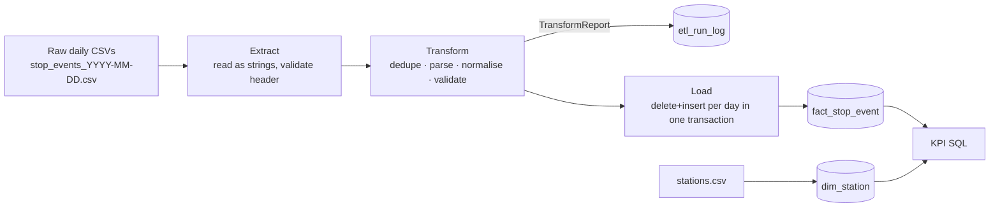

# Train Delay ETL Pipeline (Deutsche Bahn-style data → DuckDB)


A batch ETL pipeline that turns messy daily train stop-event files into a clean DuckDB star schema and computes punctuality KPIs: per station, train category, hour of day and day type.

## Problem

Timetable APIs such as Deutsche Bahn's deliver one snapshot per poll: compact timestamps (`yyMMddHHmm`), duplicate rows from overlapping polls, missing actual times, cancellations as flags, and inconsistent free text. Before anyone can answer *"Which stations are least punctual during rush hour?"*, the data has to be deduplicated, validated and modelled, and reloading a day must never double-count.

## Approach



- **Extract:** every column is read as a string, so nothing is silently coerced. A missing column fails fast.
- **Transform:** exact duplicates are removed. Categories and station names are normalised. Timestamps are parsed. Rows that can't be scored or are implausible get dropped: no actual time and not cancelled, more than 5 min early, or more than 10 h late. When a later poll corrects a stop, the latest actual time wins. Every rule has a counter in `TransformReport`, so data loss is visible in the logs.
- **Punctuality** follows the Deutsche Bahn definition: a stop counts as punctual if the delay is **under 6 minutes**. It's calculated over stops that actually ran. Cancellations are reported separately.
- **Load:** a star schema (`dim_station`, `fact_stop_event`) in DuckDB. Each service day is replaced inside a single transaction (delete + insert), so the pipeline is **idempotent**: re-running any date range gives identical results, and a test proves it.

## Results

These come from `make run`: 30 days of generated data, about 61,000 raw rows, of which 59,401 survived cleaning.

> **Note:** the data is synthetic. The generator deliberately builds in rush hours, busier hubs and weekend effects. These results show that the pipeline finds those patterns correctly. They are not claims about real Deutsche Bahn performance.

| Metric | Value |
|---|---|
| Punctuality (stops < 6 min late) | **79.8 %** |
| Cancellation rate | 2.46 % |
| Average delay when late | 7.3 min |
| Rows removed as duplicates | ~3.8 % per day |

| Category | Punctuality | p95 delay |
|---|---|---|
| ICE | 73.0 % | 28 min |
| IC | 74.3 % | 25 min |
| RE | 82.9 % | 13 min |
| S | 87.2 % | 10 min |

- Least punctual stations: Köln Hbf (71.5 %), Frankfurt (Main) Hbf (74.0 %), Hamburg Hbf (75.3 %).
- Rush hours (07–08 and 16–18) drop to about **70 %**, against about 86 % the rest of the day.
- Weekends are more punctual than weekdays: 84.4 % vs 78.0 %.

## How to run

```bash
make install      # pip install -r requirements.txt && pip install -e .
make test         # 11 tests
make run          # generate 30 days → ETL → KPI report
```

Or step by step:

```bash
python -m db_delay_etl.pipeline generate --start 2026-10-01 --days 30
python -m db_delay_etl.pipeline run --start 2026-10-10 --end 2026-10-12   # reload a range
python -m db_delay_etl.pipeline report
```

## Project structure

```
src/db_delay_etl/
  generate.py   synthetic, deliberately messy raw files (seeded, reproducible)
  extract.py    file discovery by date range, header validation
  transform.py  cleaning rules + TransformReport
  load.py       DuckDB DDL, idempotent partition loads, run log
  kpis.py       KPI SQL queries
  pipeline.py   CLI (generate / run / report)
data/reference/stations.csv   station dimension (EVA-style IDs)
tests/                        unit tests for each rule + end-to-end idempotency tests
```

## What I'd do next

- Swap the generator for the real DB Timetables API (DB API Marketplace, needs a free key), with an incremental extractor that keeps a watermark.
- Schedule daily runs with Airflow or GitHub Actions, and alert when `etl_run_log` shows an unusual drop rate.
- Write the facts as partitioned Parquet so they can be queried from a BI tool.
- Add data-quality checks (pandera or Great Expectations) as a gate before loading.

## Interview notes

- **Why delete + insert per day instead of upsert?** The source delivers whole days, so replacing a partition is simple and atomic, and it makes backfills trivial. One transaction means readers never see a half-loaded day.
- **Why read everything as strings?** It stops pandas from silently guessing types, for example turning a bad timestamp into NaN with no record of it. Parsing is done explicitly, and failures are counted.
- **Why the TransformReport?** Silent row loss is the most common ETL bug. Logging a count for every rule makes the drop rate something you can monitor.
- **Why "latest actual wins" for the same trip/station/time?** Later polls correct earlier ones. Keeping the last value matches how the source behaves.
- **Why DuckDB?** It's an in-process analytical database: no server, fast columnar SQL, ideal for a single-node pipeline. The same SQL would port to Postgres or BigQuery.
